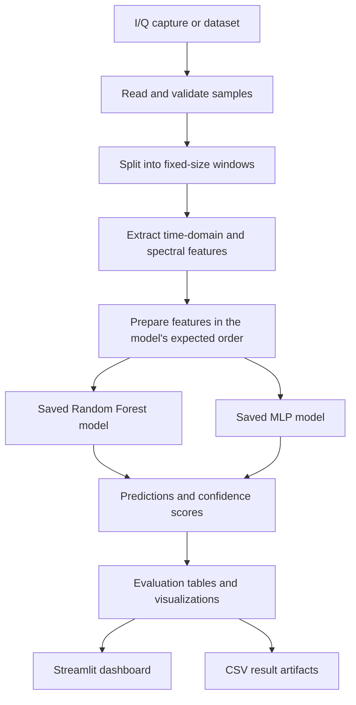
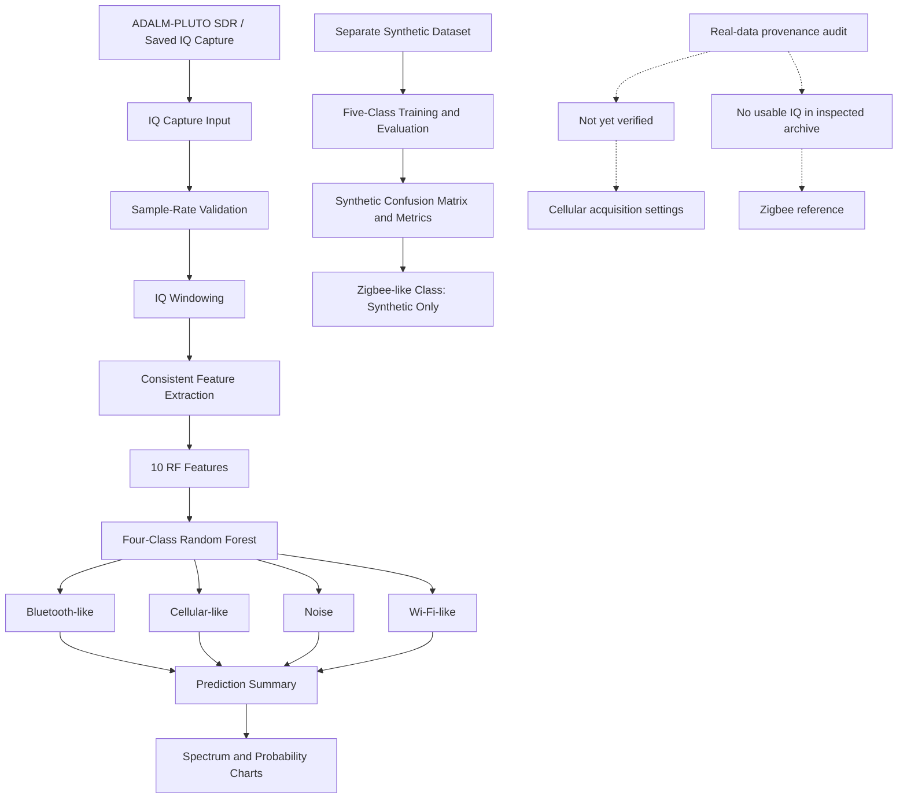

# RFRecon AI --- Software-Defined Radio Signal Classification

> **Analyze complex I/Q samples, extract RF features, and compare
> machine-learning predictions---while keeping dataset provenance and
> evaluation limitations visible.**

RFRecon AI is an experimental software-defined radio (SDR) project for
exploring radio-frequency (RF) signal classification from complex
in-phase/quadrature (I/Q) samples. The project combines signal
windowing, time-domain and spectral feature extraction, saved
machine-learning classifiers, PlutoSDR capture analysis, stress testing,
evaluation utilities, and a Streamlit dashboard.

The project currently explores five configured signal categories:
`noise`, `wifi_like`, `bluetooth_like`, `zigbee_like`, and
`cellular_like`.

**Important:** A model prediction is not proof that a particular
protocol is present. Results depend on representative data,
independently verified labels, and a consistent feature pipeline. Some
real-capture labels and evaluation results remain unverified; this
repository therefore treats RFRecon as an experimental research and
demonstration system, not a production-grade protocol-identification
tool.

------------------------------------------------------------------------

## Table of Contents

-   [Problem Statement](#problem-statement)
-   [Objectives](#objectives)
-   [Key Features](#key-features)
-   [System Architecture](#system-architecture)
-   [Signal Processing Pipeline](#signal-processing-pipeline)
-   [Feature Set](#feature-set)
-   [Machine-Learning Models](#machine-learning-models)
-   [Streamlit Dashboard](#streamlit-dashboard)
-   [Dataset and Data Organization](#dataset-and-data-organization)
-   [Evaluation Results Already
    Present](#evaluation-results-already-present)
-   [Validation Limitations](#validation-limitations)
-   [Project Structure and Important
    Files](#project-structure-and-important-files)
-   [Technology Stack](#technology-stack)
-   [Installation on Windows](#installation-on-windows)
-   [Run the Dashboard](#run-the-dashboard)
-   [Run the Batch Prediction Script](#run-the-batch-prediction-script)
-   [Reproducibility and Safe
    Evaluation](#reproducibility-and-safe-evaluation)
-   [Current Status and Next Steps](#current-status-and-next-steps)
-   [Limitations](#limitations)
-   [Conclusion](#conclusion)

------------------------------------------------------------------------

## Problem Statement

Wireless environments contain signals with different characteristics,
bandwidths, modulation patterns, power levels, and temporal behavior.
Inspecting raw I/Q captures manually can be difficult, particularly when
comparing many windows or multiple capture files.

RFRecon explores a software-based workflow that converts I/Q samples
into measurable features and uses trained classifiers to estimate which
configured signal category a window resembles. It also provides analysis
and visualization tools to compare predictions and inspect model
behavior.

This is a classification and analysis experiment. It does not
independently establish a transmitter's identity, prove protocol
compliance, or guarantee reliable identification in an unknown RF
environment.

## Objectives

-   Process complex I/Q data in fixed-size windows.
-   Calculate time-domain and frequency-domain features.
-   Compare predictions from Random Forest and Multi-Layer Perceptron
    (MLP) models.
-   Examine synthetic data and existing SDR captures.
-   Inspect model behavior under selected stress conditions.
-   Summarize existing evaluations and model comparisons.
-   Provide a local dashboard for exploring available results.
-   Make data provenance, label uncertainty, and evaluation limitations
    explicit.

## Key Features

-   **I/Q window analysis:** Supports workflows using fixed-size sample
    windows; 4,096 complex samples are used by several existing feature
    datasets.
-   **Feature extraction:** Includes power, amplitude, variance, and
    spectral measurements.
-   **Two classifier families:** Saved Random Forest and MLP artifacts
    are available for comparative prediction.
-   **Capture analysis:** Includes work with existing PlutoSDR capture
    files.
-   **Synthetic-data experiments:** Includes training and stress-test
    datasets.
-   **Evaluation artifacts:** Existing CSVs and plots record selected
    comparisons and metrics.
-   **Interactive dashboard:** A Streamlit application provides a visual
    interface for inspecting project outputs.
-   **Provenance-aware interpretation:** The documentation distinguishes
    saved experimental results from independently validated performance.

------------------------------------------------------------------------

## System Architecture

The high-level workflow is:



The repository also contains `mermaid-diagram.png`, which can be viewed
as a static diagram of the project. The diagram describes the intended
workflow; the exact behavior of any script should be confirmed from that
script and its current configuration.

### Capture, training, prediction, and provenance workflow

The following diagram separates the saved-I/Q capture path from the
synthetic training/evaluation path and highlights the outstanding real-data
provenance checks. The Random Forest branch shown here is the four-class
prediction workflow; the synthetic dataset/evaluation path contains five
configured categories. These paths should not be interpreted as evidence
that real Zigbee or cellular ground truth has been verified.



### Pipeline stages

1.  **Input:** Use an existing I/Q capture or a dataset prepared for an
    experiment.
2.  **Windowing:** Divide samples into fixed-size windows where the
    selected workflow requires it.
3.  **Feature extraction:** Calculate numerical descriptors for each
    window.
4.  **Feature preparation:** Match the names, definitions, ordering, and
    preprocessing expected by the selected trained model.
5.  **Inference:** Load the saved model artifact and produce a
    prediction and, where supported, a score.
6.  **Evaluation:** Compare predictions with labels only where suitable
    ground truth is available.
7.  **Reporting:** Save or inspect result tables and visualizations
    through the available scripts and dashboard.

------------------------------------------------------------------------

## Signal Processing Pipeline

RFRecon works with complex I/Q samples. A sample is represented by an
in-phase component (I) and a quadrature component (Q), which together
preserve amplitude and phase information.

Several existing datasets use windows of **4,096 complex samples**.
Window length, sample rate, center frequency, data format, and other
acquisition metadata must be checked for each capture rather than
assumed to be correct for every file.

For a window (x\[n\]), the magnitude is (\|x\[n\]\|), and instantaneous
power is commonly represented by (\|x\[n\]\|\^2). The project calculates
summary and spectral features from windows and passes selected features
to trained models.

### Five configured categories

  Label              Intended category
  ------------------ ------------------------
  `noise`            Noise-like samples
  `wifi_like`        Wi-Fi-like samples
  `bluetooth_like`   Bluetooth-like samples
  `zigbee_like`      Zigbee-like samples
  `cellular_like`    Cellular-like samples

The suffix `like` is intentional: it describes the dataset's intended
category, not independently verified protocol identity. The quality of
the label depends on how the source signal was generated or captured and
how its metadata was verified.

------------------------------------------------------------------------

## Feature Set

The existing feature workflows include the following measurements:

  -----------------------------------------------------------------------
  Feature                             Description
  ----------------------------------- -----------------------------------
  `mean_power`                        Average squared magnitude of the
                                      samples

  `rms`                               Root mean square magnitude

  `peak_amplitude`                    Largest sample magnitude in a
                                      window

  `variance`                          Variability of the relevant sample
                                      or magnitude values, according to
                                      the extractor

  `peak_frequency_normalized`         Normalized location of the
                                      strongest spectral component

  `spectral_centroid_normalized`      Normalized spectral center of mass

  `spectral_bandwidth_normalized`     Normalized spread of spectral
                                      energy

  `occupied_bandwidth_normalized`     Normalized bandwidth occupied under
                                      the extractor's definition

  `spectral_flatness`                 Measure of how noise-like or
                                      tone-like a spectrum is

  `peak_to_average_ratio`             Peak level relative to the average
                                      level
  -----------------------------------------------------------------------

**Feature consistency is essential.** The exact mathematical
definitions, FFT conventions, scaling, normalization, sample format, and
feature ordering must match between training and inference. The current
final-system script has been noted to use some definitions that differ
from existing feature extractors. Until this discrepancy is resolved and
validated, predictions and previously reported scores must be treated
cautiously.

------------------------------------------------------------------------

## Machine-Learning Models

### Random Forest

A saved Random Forest model is used as a primary classifier in the
final-system workflow. Random Forest combines predictions from multiple
decision trees. Its output is still dependent on the training data and
feature pipeline.

### Multi-Layer Perceptron (MLP)

A saved MLP model provides a second prediction for comparison. An MLP
learns nonlinear relationships between input features and class labels.

### Comparing predictions

The project can compare the outputs of the two model families. Agreement
can be useful for analysis, but it does **not** prove that a prediction
is correct. A confidence or probability-like score should not be
interpreted as a calibrated probability unless calibration has been
evaluated.

The scripts load saved model and feature artifacts. Keep each model
paired with the correct feature list and preprocessing procedure.

------------------------------------------------------------------------

## Streamlit Dashboard

The repository includes `rfrecon_web_dashboard.py`, a Streamlit
application intended to provide a visual interface to project data and
evaluation outputs.

### Start the dashboard

From the project root with the virtual environment activated, run:

``` cmd
python -m streamlit run rfrecon_web_dashboard.py
```

Streamlit prints a local URL in the terminal, typically:

``` text
http://localhost:8501
```

Open the URL shown in your own terminal. The repository also includes
`.streamlit/config.toml` for the dashboard's visual configuration.

Dashboard views and available controls are determined by the current
version of `rfrecon_web_dashboard.py` and the files present locally. The
dashboard is an analysis interface; it does not independently validate
capture labels or make model outputs ground truth.

------------------------------------------------------------------------

## Dataset and Data Organization

The project contains synthetic training data, feature tables, saved
evaluation outputs, and existing RF capture-related files. The exact
contents vary by checkout and local data availability.

A known training-data organization uses class-named folders:

``` text
robust_training_data/
├── noise/
├── wifi_like/
├── bluetooth_like/
├── zigbee_like/
└── cellular_like/
```

The folders can contain NumPy `.npy` arrays. Inspect the actual files
and metadata before assuming a particular sample format, sample rate,
center frequency, or label provenance.

### Existing data and metadata examples

The repository's working data has included artifacts such as:

-   `hybrid_training_dataset.csv`
-   `robust_training_dataset.csv`
-   `stress_test_dataset.csv`
-   `real_dataset/cellular_01_candidate_features.csv`
-   `real_dataset/ieee802154_6lowpan_features.csv`
-   `real_dataset/cellular_01_windows_metadata.csv`
-   `baseline_model_comparison.csv`
-   `capture_bandwidth_comparison.csv`
-   `band_noise_wifi_separation.csv`

These names describe existing or previously inspected artifacts; not
every file is guaranteed to exist in every clone. Refer to the actual
repository tree for the current set.

### Real versus synthetic data

Keep a clear record of whether a sample is synthetic, captured from
hardware, or derived from a capture. A feature row generated from a real
capture is not the same thing as an independently verified real-world
protocol example.

For real captures, retain the original file and document, where known:

-   Source capture filename and acquisition method.
-   Sample format and whether samples are complex I/Q.
-   Sample rate and center frequency.
-   Window size and extraction settings.
-   Intended class and how that label was verified.
-   Any filtering, resampling, normalization, or other preprocessing.

Some existing capture metadata has inconsistencies or unverified
settings. Do not silently replace unknown metadata with assumptions.

------------------------------------------------------------------------

## Evaluation Results Already Present

The current project documentation records these results from existing
artifacts:

  Experiment                        Random Forest      MLP
  ------------------------------- --------------- --------
  Hybrid validation                        99.38%   98.96%
  Unseen real Wi-Fi experiment               100%     100%
  PlutoSDR capture 02                      99.95%   99.82%
  PlutoSDR capture 03                        100%     100%
  Synthetic low-SNR stress test            97.84%   79.08%

A separate four-class temporal evaluation reported **69.33% accuracy**
and a **69.06% macro F1-score**. It used windows from existing captures
rather than an independent capture for each class.

**These are previously reported project results, not independently
revalidated measurements.** Their datasets, labels, feature pipelines,
and evaluation protocols are not necessarily equivalent. In particular,
high agreement or high confidence on a capture does not establish
correctness without independently verified ground truth.

Do not present the table as a single directly comparable benchmark. For
a formal report, include the relevant dataset, split method, number of
independent captures, class-wise metrics, confusion matrix, and exact
feature pipeline for each experiment.

------------------------------------------------------------------------

## Validation Limitations

The following limitations have been identified in the project:

-   Synthetic training signals have been normalized to approximately
    unit average power, limiting the usefulness of raw power and RMS
    features for separating synthetic classes.
-   Synthetic and real-data feature extraction methods are not fully
    consistent.
-   Some classes have only one source capture available, limiting
    independent-capture evaluation.
-   The real Zigbee-like and cellular-like labels have not been
    independently verified.
-   Windows from the same capture can be highly correlated. Randomly
    splitting windows from one capture across training and test sets can
    cause leakage and overstate generalization.
-   A prediction labelled `wifi_like`, `bluetooth_like`, `zigbee_like`,
    or `cellular_like` does not prove that the corresponding protocol is
    present.
-   Agreement between Random Forest and MLP is not a substitute for
    ground-truth validation.
-   A score from one experiment should not be compared directly with a
    score from a different dataset or evaluation protocol without
    explaining the differences.

A stronger evaluation should use independently captured and
independently labelled signals, capture-aware train/test splits, a
consistent extractor, class-wise precision and recall, macro F1, and a
confusion matrix.

------------------------------------------------------------------------

## Project Structure and Important Files

The exact repository contents can change as the project evolves.
Important files and artifacts identified in the project include:

  -----------------------------------------------------------------------------
  File or directory                         Purpose
  ----------------------------------------- -----------------------------------
  `rfrecon_web_dashboard.py`                Streamlit dashboard

  `.streamlit/config.toml`                  Streamlit appearance and server
                                            configuration

  `rfrecon_final_system.py`                 Batch prediction and final-system
                                            workflow

  `rfrecon_hybrid_model.pkl`                Saved Random Forest model artifact

  `rfrecon_hybrid_features.pkl`             Feature list associated with the
                                            hybrid/Random Forest workflow

  `rfrecon_mlp_model.pkl`                   Saved MLP model artifact

  `rfrecon_mlp_features.pkl`                Feature list associated with the
                                            MLP workflow

  `hybrid_training_dataset.csv`             Existing hybrid dataset

  `robust_training_dataset.csv`             Existing synthetic training dataset

  `stress_test_dataset.csv`                 Existing synthetic stress-test
                                            dataset

  `real_dataset/`                           Real-capture-related files, derived
                                            features, and metadata

  `robust_training_data/`                   Class-organized NumPy training
                                            samples, where present

  `four_class_baseline_oct17_results.csv`   Saved four-class evaluation metrics

  `rfrecon_final_summary.csv`               Previously saved final-capture
                                            summary

  `RFRecon_final_results_table.csv`         Existing experiment comparison
                                            table

  `mermaid-diagram.png`                     Static project diagram

  `RFRecon_architecture.mmd`                Mermaid architecture source, where
                                            present

  `RFRecon_demo_script.md`                  Demo/presentation notes, where
                                            present

  `requirements.txt`                        Python dependencies
  -----------------------------------------------------------------------------

Not all listed files are guaranteed to be present in every checkout.
Model files and large capture datasets may need to be supplied
separately if they are not tracked by Git.

------------------------------------------------------------------------

## Technology Stack

  -----------------------------------------------------------------------
  Technology                          Role
  ----------------------------------- -----------------------------------
  Python                              Main implementation language

  NumPy                               Complex arrays and numerical
                                      operations

  pandas                              Tabular data and CSV processing

  scikit-learn                        Machine-learning models and
                                      evaluation utilities

  joblib / pickle artifacts           Loading saved model and feature
                                      artifacts

  SciPy                               Signal-processing functionality
                                      used by feature-extraction scripts

  Streamlit                           Local interactive dashboard

  Plotly                              Interactive charts used by the
                                      dashboard, where configured

  PlutoSDR                            Source of existing SDR captures
                                      used in project experiments

  Git and GitHub                      Version control and project sharing
  -----------------------------------------------------------------------

The actual requirements and supported versions are defined by
`requirements.txt` and the working Python environment.

------------------------------------------------------------------------

## Installation on Windows

Run commands from the project root directory.

### 1. Open the project directory

``` cmd
cd "C:\Users\admin\Desktop\Notes of all subjects\BTECH CPSS\Projects\SEM-3\RFRecon_AI"
```

Use your actual project path if it differs.

### 2. Create and activate the virtual environment

If `.venv` already exists, do not recreate it unnecessarily. Activate it
in Command Prompt:

``` cmd
.venv\Scripts\activate.bat
```

If you have not created a virtual environment yet:

``` cmd
python -m venv .venv
.venv\Scripts\activate.bat
```

### 3. Install dependencies

``` cmd
python -m pip install --upgrade pip
python -m pip install -r requirements.txt
```

If installation fails, check the error and the Python version expected
by the dependencies before changing package versions. Keep the
dependency list consistent with the tested environment.

### 4. Confirm the dashboard dependency

``` cmd
python -m streamlit --version
```

If the command reports that Streamlit is missing, install the
dependencies from `requirements.txt` in the activated environment and
check the output.

### 5. Protect local configuration and data

Do not commit API keys, passwords, private credentials, or other
secrets. Review large capture files and any dataset licensing or privacy
requirements before publishing them. Preserve original captures and
existing evaluation artifacts before running scripts that may rewrite
results.

------------------------------------------------------------------------

## Run the Dashboard

With `.venv` activated and the current directory set to the project
root:

``` cmd
python -m streamlit run rfrecon_web_dashboard.py
```

Open the local address printed by Streamlit. Stop the server with
`Ctrl+C` in the terminal.

If the dashboard reports missing files, verify that the required model
artifacts, feature lists, and result files exist at the paths expected
by the application. Do not rename or replace model artifacts without
checking the code that loads them.

## Run the Batch Prediction Script

The repository includes `rfrecon_final_system.py` for the final-system
prediction workflow. Run it only after checking its configured input
paths and expected model artifacts:

``` cmd
python rfrecon_final_system.py
```

The script may process files or generate outputs based on its current
configuration. Inspect the script first if you need to know exactly
which files it reads or writes. Back up important results before
executing a workflow that may overwrite them.

------------------------------------------------------------------------

## Reproducibility and Safe Evaluation

For defensible evaluation:

1.  **Freeze the feature pipeline.** Use identical feature definitions,
    scaling, ordering, and preprocessing during training and inference.
2.  **Split by capture, not only by window.** Where possible, keep
    windows from one capture entirely within one split to reduce data
    leakage.
3.  **Preserve ground truth.** Document how the source signal and class
    label were verified.
4.  **Report per-class results.** Include precision, recall, F1-score,
    support, and a confusion matrix.
5.  **Compare appropriate baselines.** Use the same test captures and
    evaluation protocol for each model.
6.  **Keep experiments reproducible.** Record model version, feature
    extractor version, dataset manifest, random seed where relevant, and
    evaluation settings.
7.  **Preserve existing results.** Before running scripts that write
    CSVs, plots, models, or summaries, check the output paths and make a
    separate backup if the current results must be retained.
8.  **Separate evidence from assumptions.** Mark synthetic data,
    unverified labels, estimated metadata, and derived features
    explicitly.

------------------------------------------------------------------------

## Current Status and Next Steps

### Implemented or present in the project

-   Saved Random Forest and MLP model artifacts.
-   Synthetic training and stress-test datasets.
-   I/Q feature-extraction and capture-analysis workflows.
-   Existing PlutoSDR capture-related artifacts.
-   Saved evaluation CSVs and comparison results.
-   Streamlit dashboard and dashboard configuration.
-   Project architecture and demo documentation.
-   **Task 1 — Feature consistency audit:** Compared
    `rfrecon_consistent_features.py`, `audit_feature_formulas.py`,
    `audit_classifier_pipeline.py`, and existing feature extractors; the
    audit documented differences that still need to be resolved in code.
-   **Task 2 — Safe pipeline validation:** Completed read-only audits and
    documented safe validation practices that preserve existing model and
    result files.
-   **Task 3 — Independent real-signal evaluation review:** Reviewed
    capture independence, labels, and acquisition metadata; the audit
    documented where the available evidence is insufficient to claim
    independent real-signal validation.
-   **Task 5 — Capture-aware splitting review:** Documented source-capture
    identifiers and the need to prevent windows from the same capture
    appearing in both training and test sets.
-   **Task 6 — Final evaluation protocol:** Documented the required split
    method, class-wise precision/recall/F1, confusion matrix, and
    limitations.
-   **Task 7 — Data provenance audit:** Documented source files, sample
    rates, center frequencies, capture IDs, labels, and acquisition details
    that remain unverified.

The selected documentation and source-audit tasks (1, 2, 3, 5, 6, and 7)
are complete and committed. Task 4 was intentionally skipped. Completing
the audits does not mean the underlying feature discrepancies, real-signal
ground truth, or independent-capture performance have all been verified
or corrected.

------------------------------------------------------------------------

## Limitations

-   RFRecon is an experimental research project, not a certified RF
    identification system.
-   The classifiers can make incorrect predictions on unseen signals or
    under changed capture conditions.
-   Labels containing `like` indicate intended categories, not verified
    protocol identity.
-   Some real-capture metadata and labels remain unverified.
-   Inconsistent feature extraction can invalidate comparisons between
    training and inference.
-   Results from correlated windows may overestimate performance if
    capture leakage is present.
-   Model confidence and agreement do not establish correctness.
-   Existing high scores have not all been independently revalidated.
-   Performance should not be generalized beyond the datasets and
    conditions actually tested.
-   The dashboard visualizes available project artifacts; it does not
    itself establish ground truth.

------------------------------------------------------------------------

## Conclusion

RFRecon AI provides an experimental SDR workflow for extracting features
from complex I/Q samples, comparing Random Forest and MLP predictions,
examining existing capture data, and visualizing saved results through a
Streamlit dashboard. The documentation and source-audit work selected for
Tasks 1, 2, 3, 5, 6, and 7 is complete. These audits make feature-pipeline
differences, capture-independence concerns, evaluation requirements, and
provenance gaps explicit; Task 4 was intentionally skipped.

Completion of the audits is not the same as resolving every technical
limitation. Feature formulas still need to be aligned and tested, and real
Zigbee-like and cellular-like ground truth and independent-capture
performance remain unverified where the available evidence is insufficient.
Reliable real-world protocol classification requires consistent feature
extraction, independent captures, verified labels, and a leakage-resistant
evaluation design.

**Project principle:** Treat predictions as hypotheses, preserve the
provenance of every capture, and make performance claims only when the
evaluation protocol supports them.
